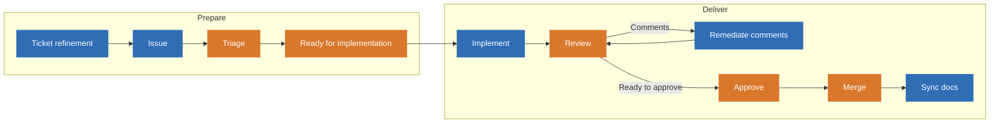

# Shop 6 Agentic

Our daily workflow with agents

  
🤖 agent

  
you decide → next task

Shop 6 · Engineering sharing

<!--
Share how Shop 6 uses agents in daily delivery, what we have learned, and how our engineering role changes as agents handle implementation. Keep current practice distinct from proposed improvements.
-->

---

# Our workflow

From ticket to implementation, review, and docs.

<!--
This is the current Shop 6 sequence supplied by the team: ticket refinement → issue → triage → ready for implementation → implement → review → remediate comments → review → approve → merge → sync docs. Review and remediation repeat until the changes are ready for approval. Approval is separate from merge. Colors distinguish execution steps from decision/checkpoint stages; they do not assign an unconfirmed human or agent owner to triage or readiness.
-->

---

# Agentic workflows

At Shop 6, we use GitHub Agentic Workflows to automate daily tasks.

  

    
Implementation planning

    
Read the issue and repository context. Prepare the approach, task breakdown, and verification plan.

    
Output: a reviewable implementation plan

  

  

    
Task implementation

    
Work from a ready issue and spec. Implement the scoped change, run checks, and return evidence.

    
Output: changes ready for review

  

  

    
Documentation updates

    
Find docs affected by merged changes. Update them to match the implementation and prepare a docs PR.

    
Output: documentation changes to review

  

Configured trigger → focused agent task → reviewable output + evidence

<a href="https://github.github.com/gh-aw/about/" class="underline">GitHub Agentic Workflows</a> · Agent tasks run through GitHub Actions.

<!--
The team identifies three uses of GitHub Agentic Workflows: implementation planning, task implementation, and documentation updates. Explain their inputs and reviewable outputs, then show the actual configured triggers and artifacts in the demo; do not invent label names, commands, or automatic stage transitions. GitHub Agentic Workflows defines agent tasks using Markdown instructions and configuration and runs them through GitHub Actions. Official reference: https://github.github.com/gh-aw/about/. In Shop 6, these tasks fit inside the current delivery flow; triage, readiness, the review/remediation loop, approval, and merge remain explicit stages.
-->

---

# What agents do, what we do

  

    
Agents

    <ul class="mt-4 space-y-3 text-lg">
      <li>Gather context and draft plans</li>
      <li>Implement tasks and run checks</li>
      <li>Review changes and remediate comments</li>
      <li>Update documentation</li>
    </ul>
  

  

    
We

    <ul class="mt-4 space-y-3 text-lg">
      <li>Understand the business and choose priorities</li>
      <li>Design solutions and define success</li>
      <li>Set boundaries and verify evidence</li>
      <li>Own approval, merge, and outcomes</li>
    </ul>
  

<!--
Agents carry more execution across the Shop 6 workflow: context gathering, planning, implementation, checks, review assistance, comment remediation, and documentation updates. Engineers remain responsible for business priorities, design decisions, clear acceptance criteria, boundaries, and acceptance of the result. Agent review supports the decision; engineers own approval and merge. Keep triage and readiness as explicit workflow stages without inventing their automation or ownership.
-->

---

# What the engineering team needs to do

  

    
Use agents daily

    
Delegate focused tasks across planning, coding, review, and docs.

  

  

    
Write clear specs

    
Define business value, design, scope, and acceptance criteria.

  

  

    
Set boundaries

    
State what to do, what to avoid, and when to stop or ask.

  

  

    
Choose the right model

    
Match task complexity, quality needs, speed, and cost.

  

  

    
Control quality and spend

    
Require evidence. Set cost, time, and retry limits.

  

  

    
Improve the workflow

    
Turn lessons into better specs, rules, skills, and checks.

  

<!--
These are the team's ongoing responsibilities and recommended improvements, not a claim that every control is already automated. Keep AGENTS.md, wiki, and repository context useful. Give each task a focused spec with do/don't instructions, acceptance evidence, and clear stop conditions: done, blocked, budget exhausted, or repeated failures. Choose the model based on observed task quality, cost, and speed. Enforce spending and runtime caps in the runner or provider where supported; a prompt alone is not a reliable hard cap. Verify diffs, tests, and spec coverage before acceptance. Save lessons in shared instructions, skills, templates, and checks so future tasks improve.
-->

---

# What we learn

A daily loop: business goal → spec → bounded execution → evidence → learn.

  

    
Before: make the work clear

    
Define value, design, acceptance criteria, scope, model, and budget. Decide what needs a human.

  

  

    
During: give autonomy within limits

    
Use focused tasks and checkpoints. Stop when done, blocked, or at the cost / time / retry cap.

  

  

    
After: accept with evidence

    
Review the diff, tests, and spec coverage. Compare delivery time, defects, rework, and spend.

  

  

    
Learn: change the workflow

    
Too expensive? Add enforced budget caps. Repeated mistakes? Update specs, rules, tests, or skills.

  

Keep the useful lesson. Check that the next run actually improves.

<!--
This is a proposed daily habit, not a claim that all these controls are already automated at Shop 6. Add agents to more steps: context gathering, ticket refinement, design alternatives, implementation, testing, review, and docs. Separate independent tasks only when the extra coordination and model spend are justified. Example lesson: an expensive run should lead to an enforced runner/provider spending limit where available, a timebox, limited retries, and a clear stop report. Budget exhaustion means report partial progress and ask for a decision; it does not mean silently starting a new run. For ambiguous work, improve the spec and escalation rule. For recurring defects, add a regression check. Save useful lessons in AGENTS.md, skills, templates, or the workflow and verify the effect on later tasks. Measure accepted delivery and business outcomes, not just lines of code or agent activity.
-->

---

# Demo

One task through the Shop 6 workflow.

  

1 · Plan

Refined ticket → issue → triage → ready. Show the implementation plan and boundaries.

  

2 · Implement &amp; review

Show the changes and checks. Review → remediate comments → review → approve → merge.

  

3 · Sync docs

Show the documentation workflow and the resulting docs PR.

Watch for: what the agent does, where we decide, and what proves the task is done.

<!--
Use a real Shop 6 issue and its configured GitHub Agentic Workflow runs. Show the actual trigger, input instructions, implementation plan, code diff, check results, review comments, remediation, approval, merge, and documentation output. Use completed runs where a live run would take too long; say when an artifact is from a previous run. Focus on the daily workflow rather than setup instructions. End by connecting one observed lesson to a concrete spec, boundary, budget, or workflow improvement. This slide is a demo guide, not an instruction to publish issues, dispatch workflows, approve, or merge through this presentation repository.
-->
